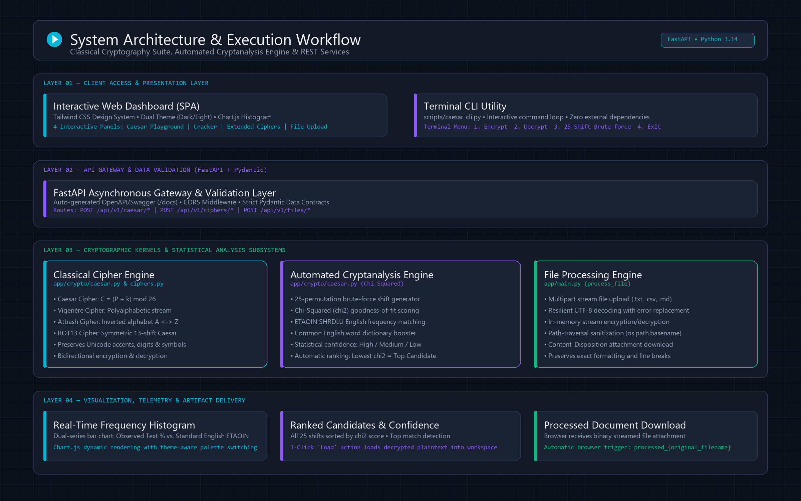

# Developer Onboarding Guide

Welcome to the **Classical Cryptography Suite & Automated Cryptanalysis Engine** project!
This guide walks you through setting up your local environment, running the application, executing tests, and understanding the project architecture.

---

## 1. Prerequisites

- **Python 3.10+** (Tested on Python 3.12 / 3.14)
- **pip** (Python package manager)
- **Git**

---

## 2. Environment Setup

### 2.1 Clone the Repository

```bash
git clone https://github.com/RishiY7/End-to-End-Encrypted-Chat.git
cd End-to-End-Encrypted-Chat
```

### 2.2 Create & Activate a Virtual Environment

**On Windows (PowerShell):**

```powershell
python -m venv .venv
.venv\Scripts\Activate.ps1
```

**On macOS / Linux:**

```bash
python3 -m venv .venv
source .venv/bin/activate
```

### 2.3 Install Dependencies

```bash
pip install -r requirements.txt
```

Optional dev tools for testing and linting:

```bash
pip install pytest
```

---

## 3. Running the Application

### 3.1 Start the FastAPI Server

Run the application with auto-reloading enabled:

```bash
uvicorn app.main:app --reload
```

### 3.2 Access the Services

| URL | Purpose |
| :--- | :--- |
| http://127.0.0.1:8000 | Web UI Dashboard |
| http://127.0.0.1:8000/docs | Interactive Swagger Docs (OpenAPI) |
| http://127.0.0.1:8000/redoc | Alternative ReDoc reference |

---

## 4. Running the Tests

Using Python's built-in `unittest` framework:

```bash
python -m unittest discover tests -v
```

Or using `pytest`:

```bash
python -m pytest tests -v
```

All 24 automated unit and integration tests run in under a second and verify:
- Caesar cipher shifting, modular wraparound, and negative shifts
- Non-ASCII, unicode, digit, and punctuation preservation
- Automated Chi-Squared ($\chi^2$) brute-force cryptanalysis scoring
- Frequency analysis calculation
- ROT13 round-trip symmetric encryption
- Atbash alphabet inversion and unicode robustness
- Vigenère encryption, decryption, and key validation
- File upload processing and streaming responses
- All 8 FastAPI REST API routes via `TestClient`

---

## 5. System Architecture & Execution Workflow



```
End-to-End Encrypted Chat/
|
+-- app/
|   +-- main.py             # FastAPI entry point, API routes, file upload endpoints
|   +-- schemas.py          # Pydantic request/response data contracts
|   +-- crypto/
|   |   +-- __init__.py
|   |   +-- caesar.py       # Caesar shift logic, Chi-squared scoring, brute-force cracker
|   |   +-- ciphers.py      # Vigenere, Atbash, and ROT13 implementations
|   +-- static/
|       +-- index.html      # Responsive web UI (Tailwind CSS, Chart.js)
|       +-- app.js          # Client-side interactivity, frequency chart rendering
|
+-- tests/
|   +-- test_ciphers.py     # Unit tests for cipher algorithms and cryptanalysis
|   +-- test_api.py         # Integration tests for all REST API endpoints
|
+-- notebooks/
|   +-- caesar_demo.ipynb   # Jupyter notebook demo and walkthrough
|
+-- scripts/
|   +-- caesar_cli.py       # Standalone CLI script (no server required)
|
+-- docs/
|   +-- ONBOARDING.md       # This file
|   +-- system_workflow_architecture.png # High-resolution architecture diagram (2400x1500)
|   +-- system_workflow_diagram.png   # Architectural overview infographic
|   +-- architecture_workflow.svg     # Scalable vector graphics workflow diagram
|
+-- requirements.txt
+-- README.md
```

---

## 6. Module Descriptions

| Module | Purpose |
| :--- | :--- |
| `app/main.py` | Defines all 8 REST endpoints, mounts static files, configures CORS |
| `app/schemas.py` | Pydantic models for request validation and response serialization |
| `app/crypto/caesar.py` | `caesar_shift()`, `score_english()`, `brute_force_crack()`, `get_frequency_analysis()` |
| `app/crypto/ciphers.py` | `vigenere_cipher()`, `atbash_cipher()`, `rot13()` |
| `app/static/index.html` | Single-page app with 4 tabs: Caesar, Cracker, Multi-Cipher, File |
| `app/static/app.js` | Fetch API calls, Chart.js histogram, tab switching, form handling |
| `tests/test_ciphers.py` | Unit test cases covering cipher algorithms, unicode preservation, and cryptanalysis |
| `tests/test_api.py` | Integration test cases covering all 8 FastAPI routes using TestClient |
| `scripts/caesar_cli.py` | Minimal standalone encrypt/decrypt/brute-force from the terminal |
| `notebooks/caesar_demo.ipynb` | Interactive notebook for demos and exploration |

---

## 7. Development Workflow & Git Best Practices

1. **Keep secrets and cache out of Git** — Never commit `.env`, `venv/`, or `__pycache__`. The `.gitignore` handles this automatically.
2. **Verify tests before committing:**
   ```bash
   python -m unittest discover tests
   ```
3. **Branching & Pull Requests:**
   - Create a feature branch: `git checkout -b feat/your-feature-name`
   - Commit clean changes: `git commit -m "feat: add feature description"`
   - Push and open a PR against `main`.
